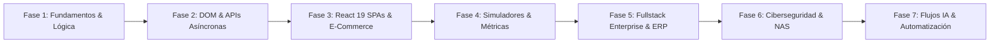

# Francisco Agustín Delgado · Master Portfolio & Interactive Project Hub

[](https://github.com/Franc-Devel)
[](https://github.com/Franc-Devel/finanzas-personales-fran-agus)
[](https://github.com/Franc-Devel)
[](https://github.com/Franc-Devel)
[](https://github.com/Franc-Devel)

Plataforma web interactiva, *landing page* de alto rendimiento y catálogo integral de proyectos de **Francisco Agustín Delgado** (Fullstack Developer & AI Software Architect). Diseñada bajo estética moderna *Dark Glassmorphism*, arquitectura de componentes desacoplada, ejecución interactiva en *Sandbox* emulado, y optimización de renderizado a 60 FPS sin *layout thrashing*.

---

## 🌟 Proyecto Destacado #01: Finanzas Personales con IA & Telegram Bot

> **Repositorio Oficial:** [Franc-Devel/finanzas-personales-fran-agus](https://github.com/Franc-Devel/finanzas-personales-fran-agus)  
> **Demo en Sandbox:** Ejecutable de forma interactiva en `./apps/finanzas-personales/index.html` con Laboratorio de IA integrado.

Sistema integral de gestión de finanzas personales, presupuestos, vencimientos y contabilidad familiar automatizado mediante visión artificial multimodal y agentes en el edge.

```
[ 📱 Ticket / Comprobante / Audio Telegram ]
                   │
                   ▼
[ 👁️ OpenAI GPT-4.1 Vision (Multimodal OCR) ] ── (Tratamiento de inputs no confiables)
                   │
                   ▼
[ ⚖️ Pipeline de Razonamiento en Dos Fases ]
    ├── GPT-6 Luna (Análisis de intención & categorización probabilística)
    └── GPT-5.4 Nano (Extracción determinística con JSON Schema estricto)
                   │
                   ▼
[ ⚡ Cloudflare Edge Workers & Webhooks ]
                   │
                   ▼
[ 🗄️ Drizzle ORM + Cloudflare D1 / SQLite ] ── (Persistencia tipada y Zero-Leak)
                   │
                   ▼
[ 📊 Dashboard SPA Reactivo & Reportes de Ahorro ]
```

### Capacidades de Ingeniería del Proyecto
1. **Visión Multimodal & OCR Adaptativo:** Ingesta de fotos de tickets arrugados, comprobantes bancarios digitales en PDF y recibos manuscritos.
2. **Defensa Activa contra Prompt Injection:** El documento y su contenido se tratan estrictamente como datos no confiables con esquemas cerrados (`additionalProperties: false`), evitando que instrucciones embebidas en comprobantes alteren las reglas de negocio.
3. **Bot Bidireccional de Telegram en Cloudflare Workers:** Captura de gastos en movilidad por texto o notas de voz transcritas en menos de 2 segundos.
4. **Base de Datos Tipada:** Persistencia relacional con Drizzle ORM sobre Cloudflare D1 / SQLite, con soporte de respaldos exportables en JSON y CSV.

---

## 🤖 Flujo de Trabajo de Ingeniería con Inteligencia Artificial (AI Workflow)

El portafolio expone cómo Francisco integra herramientas de Inteligencia Artificial para acelerar el ciclo de vida de desarrollo de software (SDLC) multiplicando por 10x la velocidad de entrega sin degradar la calidad:

1. **Percepción & Ingestión de Datos:** Modelos multimodales para extraer información de entornos físicos (documentos, imágenes, audio).
2. **Razonamiento Estructurado (Structured Outputs):** Eliminación completa de alucinaciones mediante contratos tipados con JSON Schema estricto.
3. **Ejecución Omnicanal en el Edge:** Despliegue de microservicios serverless en Cloudflare Workers con latencia global < 50ms integrados con mensajería móvil.
4. **Desarrollo Agéntico & Calidad de Código:** Generación asistida de suites de pruebas unitarias/e2e con TDD, tipado estricto con TypeScript/Drizzle y auditorías automatizadas de ciberseguridad *Zero Data Leak*.

---

## 🧭 Mapa de Evolución Técnica (7 Fases)



1. **Fase 1 · v1.0.0 (Fundamentos & Lógica Pura):** Estructuras de control, tipos numéricos y control de errores (*Calculadora Pro, Laboratorio de Lógica, Mi Primer Web*).
2. **Fase 2 · v1.5.0 (DOM & APIs Asíncronas):** Consumo asíncrono sin claves expuestas y persistencia local (*Pokédex Nacional PokeAPI, MeteoTrack Satelital, Task Flow Pro, Gestor de Alumnos CRUD*).
3. **Fase 3 · v2.0.0 (SPAs Modernas, E-Commerce & Streaming):** Enrutamiento modular, estado contextual, catálogo gamer y streaming de audio (*Francis Gamer, Francis Music Streamer, Francis Store, Titan Hard, CineApp Pro*).
4. **Fase 4 · v2.5.0 (Simuladores Técnicos & Métricas):** Algoritmos de barajado aleatorio, defensa metodológica ágil y ciencia de datos (*Modo Parcial Prog IV, Modo Defensa Software, Introducción al Análisis de Datos*).
5. **Fase 5 · v3.0.0 (Fullstack Enterprise & ERP):** Control transaccional, esquemas relacionales, POS, finanzas y gestión automotriz (*Control Central Lubricentro, CRM Abatech, Francis Bank*).
6. **Fase 6 · v3.5.0 (Ciberseguridad & NAS):** Principio de menor privilegio, almacenamiento privado en NAS y análisis forense (*Talamasca Consultora Nexo, Al Día Asistente Personal*).
7. **Fase 7 · v4.0.0 (IA Aplicada, Visión Multimodal & Automatización):** Pipelines de visión GPT-4.1, esquemas estrictos de extracción, Cloudflare Workers y bots conversacionales (*Finanzas Personales con IA & Telegram Bot*).

---

## 📦 Matriz Completa de Proyectos Integrados (21 Proyectos)

| # | Proyecto | Categoría | Stack Tecnológico | Origen | Estado / Despliegue | Acceso |
| :-: | :--- | :--- | :--- | :--- | :--- | :--- |
| **01** | **Finanzas Personales con IA** | Automatización & IA | OpenAI Vision, GPT-4.1, Telegram Bot, Drizzle, SQLite | GitHub Oficial | Standalone & Sandbox | [Abrir App](./apps/finanzas-personales/index.html) · [Repo](https://github.com/Franc-Devel/finanzas-personales-fran-agus) |
| **02** | **Francis Gamer** | E-Commerce & Gaming | React 19, Vite, Bootstrap 5, SweetAlert2 | GitHub (Vercel) | Desplegado en Vercel | [Abrir App](./apps/francis-gamer/index.html) |
| **03** | **CineApp Pro** | Streaming & Catálogo | JS Modular, CSS Bunker, CRUD de Películas | GitHub (tpIntegral) | Standalone Integrado | [Abrir App](./apps/cine-app/index.html) |
| **04** | **Francis Music** | Streaming & Audio | React, Vite, Web Audio API, Bootstrap Icons | Workspace Local | Standalone Integrado | [Abrir App](./apps/francis-music/index.html) |
| **05** | **Pokédex Nacional** | Herramientas & APIs | JS Vanilla, PokeAPI, Bootstrap 5 | GitHub (REST Client) | Standalone Integrado | [Abrir App](./apps/pokedex/index.html) |
| **06** | **Francis Bank** | Home Banking | JS, HTML5, Bootstrap 5, Módulos Financieros | GitHub (ProyectoBanco) | Standalone Integrado | [Abrir App](./apps/francis-bank/index.html) |
| **07** | **Alumnos CRUD** | Herramientas & Datos | JS, REST API / LocalStorage, Validaciones | GitHub (Admin App) | Standalone Integrado | [Abrir App](./apps/alumnos-crud/index.html) |
| **08** | **Titan Hard** | E-Commerce Gamer | HTML5, Bootstrap 5, FontAwesome, Hardware PC | GitHub (Proyecto-Ecomerce) | Standalone Integrado | [Abrir App](./apps/titan-hard/index.html) |
| **09** | **Francis Store** | E-Commerce | React, Vite, Framer Motion, Catálogo de Indumentaria | Workspace Local | Standalone Integrado | [Abrir App](./apps/francis-store/index.html) |
| **10** | **Modo Parcial Prog IV** | Simulador Académico | JS Vanilla, Algoritmos de Barajado, Timer | GitHub (Vercel) | Desplegado en Vercel | [Abrir App](./apps/modo-parcial-prog4/index.html) |
| **11** | **Modo Defensa Software** | Simulador Académico | JS Vanilla, Scrum / Kanban / GitFlow | GitHub (Vercel) | Desplegado en Vercel | [Abrir App](./apps/modo-defensa-gestion/index.html) |
| **12** | **Análisis de Datos** | Simulador Académico | JS, Conceptos Pandas & Data Science | Workspace Local | Standalone Integrado | [Abrir App](./apps/analisis-datos/index.html) |
| **13** | **Control Central Lubricentro** | Fullstack & ERP | React, Express, SQLite, Gestión Órdenes | GitHub & Local | Standalone Integrado | [Abrir App](./apps/lubricentro-dym/index.html) |
| **14** | **Al Día Asistente NAS** | Automatización & IA | JS Vanilla, Baileys, IA Local, Almacenamiento NAS | Workspace Local | Standalone Integrado | [Abrir App](./apps/asistente-aldia/index.html) |
| **15** | **Calculadora Pro** | Herramientas & Lógica | JS Vanilla, Glassmorphism, Expresiones Matemáticas | Workspace Local | Standalone Integrado | [Abrir App](./apps/calculadora/index.html) |
| **16** | **Laboratorio de Lógica** | Herramientas & Lógica | JS Vanilla, Terminal Emulada, Retos Algorítmicos | GitHub & Local | Standalone Integrado | [Abrir App](./apps/laboratorio-logica/index.html) |
| **17** | **MeteoTrack Satelital** | Herramientas & Lógica | React, Open-Meteo API, Pronóstico en Tiempo Real | GitHub & Local | Standalone Integrado | [Abrir App](./apps/meteo-clima/index.html) |
| **18** | **Task Flow Pro** | Herramientas & Lógica | React, Vite, Hook Form, Kanban Board | Workspace Local | Standalone Integrado | [Abrir App](./apps/task-flow/index.html) |
| **19** | **Mi Primer Web** | Hito Fundacional | HTML5 Semántico, CSS, Estructura Web | GitHub (mi-web) | Standalone Integrado | [Abrir App](./apps/mi-primer-web/index.html) |
| **20** | **Talamasca Consultora** | Fullstack Corporativo | Next.js, TypeScript, Arquitectura Empresarial | GitHub & Local | Arquitectura Empresarial | Caso de Estudio |
| **21** | **CRM Clientes Abatech** | Software de Gestión | Python 3, SQLite, Reportes PDF, Auditoría | Workspace Local | Arquitectura de Software | Caso de Estudio |

---

## ⚡ Rendimiento & Optimización a 60 FPS

- **Zero Layout Thrashing:** Sustitución de lecturas síncronas de propiedades de layout (`offsetTop`, `getBoundingClientRect`) en eventos de scroll por `IntersectionObserver` pasivo.
- **Content Visibility & Containment:** Aplicación de `content-visibility: auto; contain-intrinsic-size: 0 460px;` en todas las tarjetas de proyectos y elementos de la línea temporal, reduciendo el cálculo de rasterización del navegador en más de un 70%.
- **Hardware Acceleration:** Promoción de capas críticas a GPU mediante `transform: translateZ(0)` y transiciones focalizadas (`transform`, `box-shadow`) evitando `transition: all`.
- **Search Debouncing:** Debounce reactivo de 90ms en el filtrado de proyectos para garantizar una escritura fluida sin tirones visuales.

---

## 🛡️ Políticas de Ciberseguridad & Protección de Datos

- **Zero API Key Leakage:** Los proyectos no almacenan credenciales sensibles en código cliente. Los servicios consumen endpoints abiertos o arquitecturas protegidas en backend.
- **Aislamiento Estricto de Secretos:** Configuración mediante `.env.example`, bloqueando en `.gitignore` todo archivo de variables de entorno y tokens de bots.
- **Protección contra Tabnabbing:** Todo enlace con `target="_blank"` implementa rigurosamente el atributo `rel="noopener noreferrer"`.
- **Sanitización de Entradas:** Validación estricta en formularios para prevenir ataques Cross-Site Scripting (XSS) e inyecciones de código.

---

## 🚀 Ejecución y Despliegue Local

Para levantar el portafolio completo localmente:

```bash
# Navegar al directorio del proyecto
cd Landingpage

# Iniciar servidor estático ligero
python3 -m http.server 8085
```

Abrir en el navegador: `http://localhost:8085`

---

## 🌿 Flujo de Trabajo en Git (GitFlow)

El desarrollo del repositorio sigue un flujo profesional estructurado:

- `main`: Rama de producción estable.
- `develop`: Rama de integración continua.
- `feature/*`: Ramas temáticas por funcionalidad (`feature/finanzas-ia-showcase-performance-rebranding`, `feature/quantum-apps-elevation`, etc.).

---

## 👤 Autor

**Francisco Agustín Delgado**  
- GitHub: [@Franc-Devel](https://github.com/Franc-Devel)  
- Ubicación: Tucumán, Argentina  
