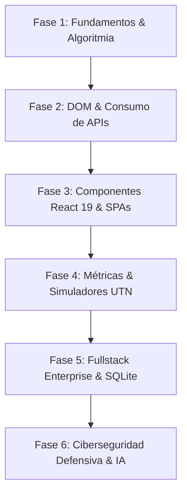

# Francisco Agustín Delgado · Master Portfolio & Interactive Project Hub

[](https://github.com/Franc-Devel)
[](https://github.com/Franc-Devel)
[](https://github.com/Franc-Devel)

Plataforma web interactiva, *landing page* y matriz integral de proyectos de **Francisco Agustín Delgado** (Fullstack Developer & Software Architect). Diseñada bajo los más altos estándares de diseño moderno (Dark Glassmorphism, Bento Grid, tipografía fluida y rendimiento a 60 FPS), documentando el crecimiento paso a paso bajo la filosofía *"Learn in Public"* y asegurando un estricto protocolo defensivo de ciberseguridad.

---

## 🌟 Características Principales

- **Diseño Visual de Grado Superior:** Paleta cromática profunda (`#070a12`), efectos de desenfoque de fondo (*backdrop blur*), iluminación ambiental y tarjetas con microinteracciones.
- **Catálogo Bento Grid con Búsqueda Instantánea:** Filtrado en tiempo real por tecnologías, áreas de aplicación y búsqueda predictiva.
- **Doble Modalidad de Acceso a Proyectos:**
  - **Ejecución en Sandbox Integrado:** Modal interactivo con emulador responsive (Desktop, Tablet y Mobile).
  - **Apertura Segura en Nueva Pestaña:** Todos los enlaces externos y aplicaciones utilizan `target="_blank" rel="noopener noreferrer"` para mantener la landing page siempre activa.
- **Línea de Tiempo de Evolución Técnica (v1.0.0 a v3.5.0):** Registro cronológico que expone la progresión desde algoritmos puros hasta sistemas de datos distribuidos y ciberseguridad.
- **Protocolo de Ciberseguridad Zero-Leak:** Cero exposición de claves privadas de entorno (`.env`), contraseñas o tokens de producción en el cliente o repositorios públicos.
- **Casos de Estudio Estructurados:** Cada proyecto documenta contexto, rol, decisiones técnicas de arquitectura y trade-offs asumidos.

---

## 🧭 Mapa de Evolución Técnica



1. **Fase 1 · v1.0.0 (Fundamentos & Lógica Pura):** Estructuras de control, validación de tipos numéricos y control de errores matemáticos (*Calculadora Pro, Laboratorio de Condicionales & Bucles*).
2. **Fase 2 · v1.5.0 (DOM & APIs Asíncronas):** Formularios reactivos, consumo asíncrono sin claves expuestas y persistencia local (*MeteoTrack Satelital, Task Flow Pro*).
3. **Fase 3 · v2.0.0 (SPAs Modernas & E-Commerce):** Enrutamiento multinivel, gestión de estado global, tiendas y streaming de audio (*Francis Gamer, Francis Music Streamer, Francis Store*).
4. **Fase 4 · v2.5.0 (Simuladores Académicos UTN):** Algoritmos de barajado aleatorio, defensa metodológica ágil y ciencia de datos (*Modo Parcial Prog IV, Modo Defensa Software, Introducción al Análisis de Datos*).
5. **Fase 5 · v3.0.0 (Fullstack Enterprise & ERP):** Control transaccional, esquemas relacionales, POS e inventarios (*Lubricentro DyM Central ERP, CRM Abatech*).
6. **Fase 6 · v3.5.0 (Ciberseguridad & IA Local):** Principio de menor privilegio, almacenamiento privado en NAS y análisis inteligente (*Talamasca Consultora Nexo, Al Día Asistente Personal*).

---

## 📦 Matriz de Proyectos Integrados

| Proyecto | Categoría | Stack Tecnológico | Estado / Despliegue | Acceso |
| :--- | :--- | :--- | :--- | :--- |
| **Francis Gamer** | E-Commerce & Gaming | React 19, Vite, Bootstrap 5 | Desplegado en Vercel | [Abrir App](./apps/francis-gamer/index.html) |
| **Francis Music** | Streaming & Audio | React, Vite, Web Audio API | Standalone Integrado | [Abrir App](./apps/francis-music/index.html) |
| **Francis Store** | E-Commerce | React, Vite, Framer Motion | Standalone Integrado | [Abrir App](./apps/francis-store/index.html) |
| **Modo Parcial Prog IV** | Simulador Académico | JS Vanilla, CSS, LocalStorage | Desplegado en Vercel | [Abrir App](./apps/modo-parcial-prog4/index.html) |
| **Modo Defensa Software** | Simulador Académico | JS Vanilla, Scrum / Agile | Desplegado en Vercel | [Abrir App](./apps/modo-defensa-gestion/index.html) |
| **Análisis de Datos** | Simulador Académico | JS, Conceptos Pandas / UTN | Standalone Integrado | [Abrir App](./apps/analisis-datos/index.html) |
| **Control Central Lubricentro** | Fullstack & ERP | React, Express, SQLite | Standalone Integrado | [Abrir App](./apps/lubricentro-dym/index.html) |
| **Al Día Asistente NAS** | Automatización & IA | JS Vanilla, Baileys, IA Local | Standalone Integrado | [Abrir App](./apps/asistente-aldia/index.html) |
| **Calculadora Pro** | Herramientas & Lógica | JS Vanilla, Glassmorphism | Standalone Integrado | [Abrir App](./apps/calculadora/index.html) |
| **Laboratorio de Lógica** | Herramientas & Lógica | JS Vanilla, Terminal Emulada | Standalone Integrado | [Abrir App](./apps/laboratorio-logica/index.html) |
| **MeteoTrack Satelital** | Herramientas & Lógica | React, Open-Meteo API | Standalone Integrado | [Abrir App](./apps/meteo-clima/index.html) |
| **Task Flow Pro** | Herramientas & Lógica | React, Vite, Hook Form | Standalone Integrado | [Abrir App](./apps/task-flow/index.html) |
| **Talamasca Consultora** | Fullstack Corporativo | Next.js, TypeScript | Arquitectura Empresarial | Caso de Estudio |
| **CRM Clientes Abatech** | Software de Gestión | Python 3, SQLite, PDF | Arquitectura de Software | Caso de Estudio |

---

## 🛡️ Políticas de Ciberseguridad & Datos

- **Zero API Key Leakage:** Los proyectos no almacenan credenciales sensibles en repositorios ni en bundles de cliente. Los servicios climáticos utilizan endpoints abiertos de Open-Meteo sin dependencias de claves privadas.
- **Aislamiento de Entornos:** Las plantillas de variables de entorno se distribuyen como `.env.example`, bloqueando en `.gitignore` todo archivo `.env` o clave privada.
- **Protección contra Tabnabbing:** Todo enlace con `target="_blank"` implementa rigurosamente el atributo `rel="noopener noreferrer"`.
- **Sanitización de Entradas:** Validación estricta en formularios para prevenir ataques Cross-Site Scripting (XSS) e inyecciones SQL.

---

## 🚀 Ejecución y Despliegue Local

Para levantar el portafolio completo de manera local:

```bash
# Navegar al directorio del proyecto
cd Landingpage

# Iniciar servidor estático ligero
python3 -m http.server 8080

# O utilizar Node.js npx serve
npx serve -l 8080
```

Acceder desde el navegador a: `http://localhost:8080`

---

## 🌿 Flujo de Trabajo en Git (GitFlow)

El desarrollo del repositorio sigue un flujo estructurado con ramas temáticas y *conventional commits*:

- `main`: Rama de producción estable.
- `develop`: Rama de integración activa.
- `feature/*`: Ramas de características específicas (*setup, styles, data, apps, ui, security*).

---

## 👤 Autor

**Francisco Agustín Delgado**  
- GitHub: [@Franc-Devel](https://github.com/Franc-Devel)  
- Correo: Franc-Devel@users.noreply.github.com  
- Ubicación: Tucumán, Argentina  
